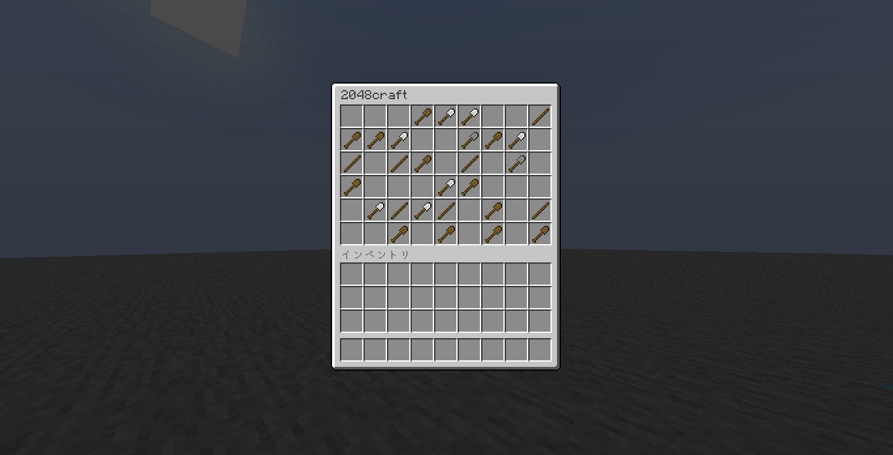

# 🎲2048Craft

# 🌎Language
English only

# 🏆How to Play
1. Execute the ``/2048craft`` command.
2. Right-click an empty slot.
3. Stack items of the same type.
4. Right-click the slot currently in use to clear its contents.
5. Repeat until the maximum stage is reached.

# 👻Creator
akua25258 (JP) - [KumaEarth](https://kumaearth.net/) Creator

# ❤️Other
Minecraft version 1.21.8 or later is recommended. 
I drew inspiration from [a post on X](https://x.com/SmileyFace1126/status/2110424384070426989?s=20).
